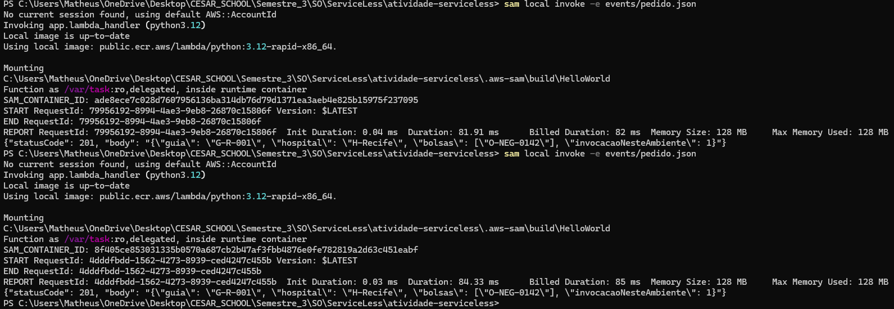
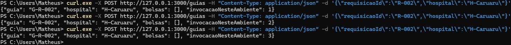
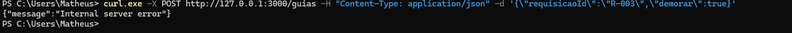
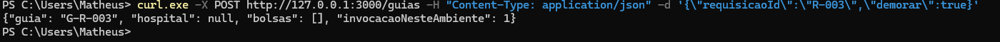
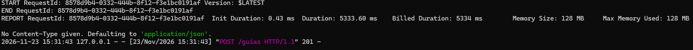

# Atividade Individual 1 — Serverless (Infraestrutura de Software)

**Curso:** Análise e Desenvolvimento de Sistemas (ADS) · CESAR School · 2026.2  
**Tema:** Função serverless acionada por evento e por HTTP para geração de guia de transporte (cenário Rota Vital).  
**Caminho escolhido:** **Caminho A (Local)** utilizando **AWS SAM CLI** + **Docker Desktop** + **Python 3.12**.

- **Vídeo de demonstração (até 3 min):** [Assistir no YouTube](https://youtu.be/UwtdjoX7Pk8)

---

## Como executar o projeto localmente

### Pré-requisitos
- **Docker Desktop** instalado e em execução.
- **AWS SAM CLI** (`sam --version`).
- **Python 3.12+** e `curl` (ou `curl.exe` no PowerShell).

### Passo a passo

1. **Clonar o repositório e acessar a pasta:**
   ```bash
   git clone [https://github.com/MatheusSrp/Atividade-individual-1-Serverless---Matheus-Vaz.git](https://github.com/MatheusSrp/Atividade-individual-1-Serverless---Matheus-Vaz.git)
   cd Atividade-individual-1-Serverless---Matheus-Vaz


---

## Evidências de Execução

Todos os prints originais estão salvos na pasta [`evidencias/`](evidencias/) deste repositório e exibidos abaixo:

### 1. Invocação por evento (`sam local invoke`)
Duas execuções consecutivas simulando o evento do API Gateway (`events/pedido.json`), retornando `201` e `invocacaoNesteAmbiente: 1` em ambas (containers distintos):


### 2. Gatilho HTTP e reaproveitamento de ambiente (`sam local start-api`)
Três requisições `POST /guias` consecutivas via `curl.exe`, demonstrando o incremento de `invocacaoNesteAmbiente` (`1`, `2`, `3`) pelo reaproveitamento do container em memória:


### 3. Erro de tempo limite (`Timeout: 3` segundos vs `sleep(5)`)
Requisição com `"demorar": true` sendo encerrada aos 3 segundos (`Task timed out after 3 seconds` / HTTP `502` / `Internal server error`):



### 4. Ajuste de tempo limite (`Timeout: 10` segundos)
Após atualizar o `Timeout` para `10` no `template.yaml` e executar `sam build`, a requisição de 5 segundos conclui com sucesso (`201 Created`):



---

## Uso de IA (PO-CESAR-021)

- **Ferramenta utilizada:** Google Gemini.
- **Finalidade:** Apoio na configuração do ambiente local (comandos de instalação do AWS SAM CLI no Windows e adaptação de escapes de aspas JSON no PowerShell), diagnóstico de cache de compilação do SAM CLI (`sam build`), revisão do roteiro do vídeo de demonstração e estruturação da documentação no `README.md`.
- **Como foi validado:** Todos os comandos, alterações no `template.yaml` e comportamentos da função (`hello_world/app.py`) foram executados e validados diretamente no ambiente local com Docker Desktop e AWS SAM CLI, conferindo os logs de execução (`RequestId`, `Duration`, `Init Duration`), os códigos de status HTTP (`201` e `502`) e os cálculos matemáticos da questão de custos.
