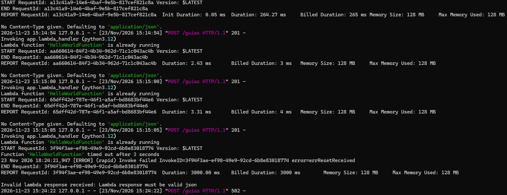

# Atividade Individual 1 — Serverless (Infraestrutura de Software)

**Curso:** Análise e Desenvolvimento de Sistemas (ADS) · CESAR School · 2026.2  
**Tema:** Função serverless acionada por evento e por HTTP para geração de guia de transporte (cenário Rota Vital).  
**Caminho escolhido:** **Caminho A (Local)** utilizando **AWS SAM CLI** + **Docker Desktop** + **Python 3.12**.

- **Vídeo de demonstração (até 3 min):** [Assistir no YouTube](https://youtu.be/UwtdjoX7Pk8)

---

## Como executar o projeto localmente

### Pré-requisitos
- **Docker Desktop** instalado e em execução.
- **AWS SAM CLI** (`sam --version`).
- **Python 3.12+** e `curl` (ou `curl.exe` no PowerShell).

### Passo a passo

1. **Clonar o repositório e acessar a pasta:**
   ```bash
   git clone https://github.com/MatheusSrp/Atividade-individual-1-Serverless---Matheus-Vaz.git
   cd Atividade-individual-1-Serverless---Matheus-Vaz
   ```

2. **Compilar a aplicação:**
   ```bash
   sam build
   ```

3. **Invocar a função diretamente com um evento simulado (API Gateway):**
   ```bash
   sam local invoke -e events/pedido.json
   ```

4. **Subir a API HTTP localmente:**
   ```bash
   sam local start-api
   ```

5. **Em outro terminal, enviar requisições HTTP (`POST /guias`):**
   - **Requisição normal (com retorno `201 Created`):**
     ```powershell
     curl.exe -X POST http://127.0.0.1:3000/guias -H "Content-Type: application/json" -d '{\"requisicaoId\":\"R-002\",\"hospital\":\"H-Caruaru\"}'
     ```
   - **Requisição com atraso simulado (`sleep` de 5 segundos para testar o `Timeout`):**
     ```powershell
     curl.exe -X POST http://127.0.0.1:3000/guias -H "Content-Type: application/json" -d '{\"requisicaoId\":\"R-003\",\"demorar\":true}'
     ```

---

## Respostas às Perguntas

### 1. Por que a primeira invocação demorou mais que a segunda? O que acontece na fase de Init?
A primeira invocação sofre o chamado **cold start** (partida a frio). Quando ainda não existe um ambiente de execução ativo pronto para atender a requisição, a plataforma precisa provisionar o container isolado, carregar a imagem do runtime (Python 3.12), montar o código da função e executar tudo o que está fora do `lambda_handler` (importações de módulos e inicialização de variáveis globais). Esse processo corresponde à **fase de Init**. Na segunda invocação — quando o ambiente já está aquecido — a fase de Init é pulada e o runtime executa diretamente o `lambda_handler`, reduzindo drasticamente o tempo de resposta (nos testes locais via `start-api`, a primeira chamada levou ~264 ms enquanto as subsequentes caíram para ~2–3 ms).

### 2. O que o campo `invocacaoNesteAmbiente` mostrou com e sem `--warm-containers`? O que isso diz sobre guardar estado numa variável global da função?
- **Sem reaproveitamento de ambiente** (como ocorre no `sam local invoke` isolado ou no modo `EAGER`/`COLD` onde cada chamada sobe e destrói um container novo): o campo `invocacaoNesteAmbiente` retornou sempre **`1`** em todas as execuções, pois a memória era zerada a cada chamada.
- **Com reaproveitamento de ambiente** (`sam local start-api` / `--warm-containers LAZY`): o campo incrementou sequencialmente (**`1`**, **`2`**, **`3`**), porque o mesmo container permaneceu ativo em memória entre chamadas consecutivas.

**Conclusão sobre estado em variáveis globais:** Não se deve confiar em variáveis globais para armazenar estado de negócio (como contadores reais, carrinhos ou dados de sessão). O ciclo de vida dos containers serverless é efêmero e gerenciado automaticamente pelo provedor: se o ambiente escalar horizontalmente (criando múltiplos containers paralelos) ou for reciclado por inatividade, o estado global é perdido ou fica inconsistente entre instâncias. Variáveis globais servem apenas para cache temporário ou reaproveitamento de conexões (como clientes de banco de dados), enquanto o estado persistente deve ficar em serviços externos (bancos de dados, filas, caches distribuídos).

### 3. O que aconteceu com `demorar = true`? Qual é o tempo máximo de uma execução no Lambda, e o que fazer com um trabalho mais longo?
Ao enviar `"demorar": true`, a função executou `time.sleep(5)`, ultrapassando o limite de `Timeout: 3` segundos configurado no `template.yaml`. Como resultado, o runtime interrompeu a execução forçadamente aos **3000 ms** (`Task timed out after 3 seconds`) e o API Gateway devolveu **HTTP 502 (`Internal server error`)**. Ao aumentar o `Timeout` para `10` segundos e refazer o `sam build`, a função completou os 5 segundos e retornou **HTTP 201** normalmente.

- **Tempo máximo no AWS Lambda:** O limite rígido de execução de uma única invocação no AWS Lambda é de **15 minutos (900 segundos)** (sendo o padrão inicial de 3 segundos; além disso, quando exposta via API Gateway síncrono, o limite da integração HTTP é ainda menor, de ~29–30 segundos).
- **O que fazer com trabalhos mais longos:** Deve-se desacoplar o processamento usando **arquitetura assíncrona orientada a eventos** — por exemplo, a função HTTP apenas recebe a requisição, grava o pedido em uma fila (**Amazon SQS** ou **EventBridge**) e responde imediatamente `202 Accepted` ao cliente, enquanto workers assíncronos (ou **AWS Step Functions** quebrando o fluxo em etapas menores, ou containers dedicados no **AWS ECS / Fargate** / **AWS Batch**) processam a tarefa pesada em segundo plano.

### 4. Com os preços de `us-east-1` da aula (US$ 0,20 por milhão de requisições e US$ 0,0000166667 por GB-s), quanto custa um milhão de execuções desta função com 128 MB e 100 ms? Mostrem a conta.

1. **Custo por requisições:**
   $$\text{Custo}_{\text{req}} = 1.000.000 \times \frac{\text{US\$ } 0,20}{1.000.000} = \text{US\$ } 0,20$$

2. **Conversão de memória e tempo para GB-segundos (GB-s):**
   - Memória em GB: $\frac{128\text{ MB}}{1024} = 0,125\text{ GB}$
   - Duração em segundos: $\frac{100\text{ ms}}{1000} = 0,1\text{ s}$
   - GB-s por execução: $0,125\text{ GB} \times 0,1\text{ s} = 0,0125\text{ GB-s}$
   - Total de GB-s para 1.000.000 de execuções:
     $$1.000.000 \times 0,0125\text{ GB-s} = 12.500\text{ GB-s}$$

3. **Custo de computação (duração):**
   $$\text{Custo}_{\text{comp}} = 12.500\text{ GB-s} \times \text{US\$ } 0,0000166667 = \text{US\$ } 0,20833375 \approx \text{US\$ } 0,21$$

4. **Custo total (desconsiderando o Free Tier):**
   $$\text{Custo}_{\text{total}} = \text{US\$ } 0,20 + \text{US\$ } 0,2083 = \mathbf{\text{US\$ } 0,4083} \text{ (aproximadamente }\mathbf{\text{US\$ } 0,41}\text{)}$$
   *(Nota: considerando o plano sempre gratuito da AWS — 1 milhão de requisições e 400.000 GB-s/mês — o custo efetivo dentro da cota gratuita seria **US$ 0,00**).*

### 5. Em que parte do Rota Vital uma função assim faria sentido, e em qual não faria?
- **Onde faz sentido:** Em operações **orientadas a eventos, curtas, stateless e com tráfego intermitente ou em picos** — exatamente como a **emissão de guias de transporte** sob demanda, validação inicial de requisições de hemocentros, envio de notificações/alertas (e-mail, SMS ou webhook) quando uma bolsa de sangue muda de status, ou geração de comprovantes em PDF/JSON após o despacho. Nessas tarefas, paga-se apenas quando há requisição e a escala é automática.
- **Onde NÃO faz sentido:** Em processos **contínuos, de longa duração ou que exigem estado persistente em memória** — como o **rastreamento GPS em tempo real via WebSockets contínuos** das ambulâncias/viaturas em trânsito, processamento pesado e demorado de relatórios históricos consolidados que ultrapassem os limites de tempo/memória do Lambda, ou fluxos com tráfego constante e muito alto 24/7, onde um servidor/container dedicado (como ECS/Fargate) teria custo mais previsível e sem impacto de *cold start*.

---

## Evidências de Execução

Todos os prints originais estão salvos na pasta [`evidencias/`](evidencias/) deste repositório e exibidos abaixo:

### 1. Invocação por evento (`sam local invoke`)
Duas execuções consecutivas simulando o evento do API Gateway (`events/pedido.json`), retornando `201` e `invocacaoNesteAmbiente: 1` em ambas (containers distintos):


### 2. Gatilho HTTP e reaproveitamento de ambiente (`sam local start-api`)
Três requisições `POST /guias` consecutivas via `curl.exe`, demonstrando o incremento de `invocacaoNesteAmbiente` (`1`, `2`, `3`) pelo reaproveitamento do container em memória:


### 3. Erro de tempo limite (`Timeout: 3` segundos vs `sleep(5)`)
Requisição com `"demorar": true` sendo encerrada aos 3 segundos (`Task timed out after 3 seconds` / HTTP `502` / `Internal server error`):



### 4. Ajuste de tempo limite (`Timeout: 10` segundos)
Após atualizar o `Timeout` para `10` no `template.yaml` e executar `sam build`, a requisição de 5 segundos conclui com sucesso (`201 Created`):


---

## Uso de IA (PO-CESAR-021)

- **Ferramenta utilizada:** Google Gemini.
- **Finalidade:** Apoio na configuração do ambiente local (comandos de instalação do AWS SAM CLI no Windows e adaptação de escapes de aspas JSON no PowerShell), diagnóstico de cache de compilação do SAM CLI (`sam build`), revisão do roteiro do vídeo de demonstração e estruturação da documentação no `README.md`.
- **Como foi validado:** Todos os comandos, alterações no `template.yaml` e comportamentos da função (`hello_world/app.py`) foram executados e validados diretamente no ambiente local com Docker Desktop e AWS SAM CLI, conferindo os logs de execução (`RequestId`, `Duration`, `Init Duration`), os códigos de status HTTP (`201` e `502`) e os cálculos matemáticos da questão de custos.
